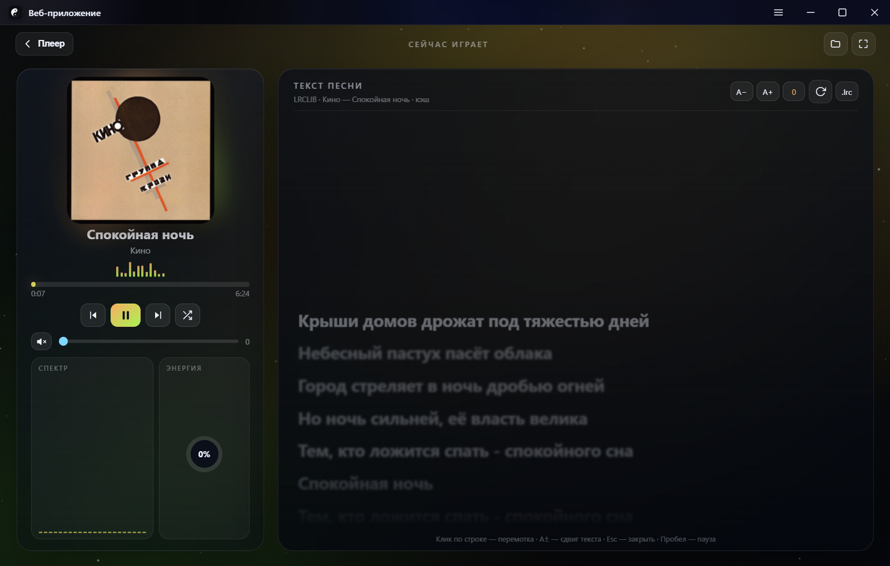
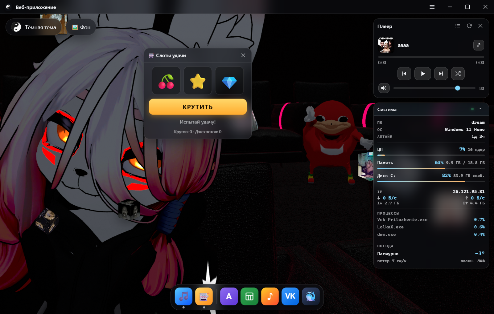

# Веб-приложение

Личный десктоп-«рабочий стол» на Electron: темы и фоны, музыка с синхронным текстом, полноэкранный плеер с живой визуализацией, док приложений, слоты и системный монитор.





## Возможности

- **Темы и фоны** — светлая/тёмная тема, смена фона, плавающие «кубы» и рамки.
- **Музыка** — папка с треками выбирается в приложении, поддержка mp3/flac/ogg/m4a/wav/aac и других форматов, чтение тегов и обложек.
- **Плеер с текстом** — синхронные `.lrc` (свои файлы или LRCLIB), караоке-заливка, клик по строке — перемотка, сдвиг текста `A±`, загрузка `.lrc`.
- **Визуализация** — звёздное небо, туманности, северное сияние, падающие звёзды, частицы на бит, спектр и энергия трека, свечение обложки.
- **Плейлист** — список треков с подсветкой текущего и автопрокруткой.
- **Системный монитор** — ЦП, память, диск, сеть, топ процессов и погода; висит под свёрнутым плеером.
- **Док и окна** — перетаскиваемые окошки, док в стиле macOS, кастомный заголовок окна.

## Установка

Скачай установщик из [Releases](../../releases):

- `VebPrilozhenie-Setup-<версия>.exe` — установка с ярлыком в меню «Пуск» и на рабочем столе;
- `VebPrilozhenie-<версия>-x64.exe` — портативная версия без установки.

> Windows 10/11 x64. Приложение не подписано — SmartScreen может показать предупреждение («Подробнее» → «Выполнить в любом случае»).

## Сборка из исходников

```bash
npm install
npm start          # запуск в режиме разработки
npm run dist       # сборка installer + portable в dist/
```

Требуется Node.js 18+.

## Как это устроено

| Слой | Технологии |
| --- | --- |
| Оболочка | Electron 45, frameless-окно, `app://` протокол, IPC |
| Интерфейс | HTML/CSS/JS без фреймворков, Canvas 2D |
| Музыка | `music-metadata`, Range-запросы, кеш обложек |
| Текст песен | локальные `.lrc` → кеш → LRCLIB |
| Системные данные | `systeminformation`, `os`, wttr.in |

```
main.js        Electron: окно, протокол, API музыки/текстов/статистики
preload.js     мост contextBridge (window.desktop)
web/           интерфейс: index.html, стили, app.js, lyrics.js, sysmon.js
build/         иконки для сборки
docs/          скриншоты
```

Музыкальная папка по умолчанию задаётся в `source.json` (пример — `source.json.example`) либо выбирается кнопкой в приложении и сохраняется в настройках пользователя.

## Лицензия

[MIT](LICENSE)
